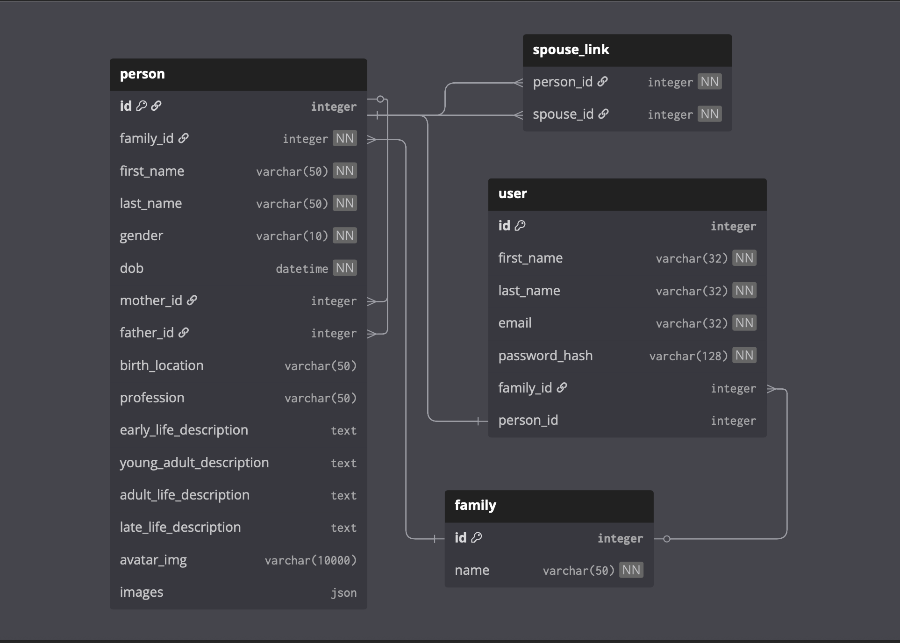

# Free Family Tree

## Project Structure

### File structure

The overall structure consists of a Python Flask backend, a React frontend,
and Nginx acting as a reverse proxy to managage client requests and serve
the React frontend files statically. Docker compose file is used to
containerise the application stack.
<br>

<b>[Backend](#Backend):</b> A classic flask file structure with the `app`
directory containing the initilisation files, views, models, static files and any other functions. Dockerfile is needed for docker compose command. `json_families` is a folder containing the data necessary to populate the database. `create_db.py` and `delete_db.py` are python functions that populate and delete the database with the `json_families` data respectivally.
<br><br>
<b>[Frontend](#Frontend):</b> Vite React project file structure. `dist`
contains static HTML files and assets used by Nginx. `index.html` is the
root html file and serves as the entry point, the React application is
mounted to the DOM here. The `src` directory contains all of the React
components needed to run the application.
<br>

<b>[Nginx](#Nginx):</b> contains the nginx config file.

<b>[Docker](#Docker):</b> docker compose is used to containerise the
applicatino to simplify deployment and CI/CD.
<br>

```bash
.
├── backend
│   └── flask-server
│       ├── app
│       │   ├── __init__.py
│       │   ├── api_functions
│       │   │   ├── __init__.py
│       │   │   └── get_functions.py
│       │   ├── api.py
│       │   ├── models.py
│       │   ├── static
│       │   │   └── uploads
│       │   └── views.py
│       ├── config.py
│       ├── create_db.py
│       ├── db.sqlite3
│       ├── delete_db.py
│       ├── Dockerfile
│       ├── json_families
│       │   ├── beckham.json
│       │   ├── coppala.json
│       │   ├── jackson.json
│       │   ├── jolie_pitt.json
│       │   ├── kardashin.json
│       │   ├── rockerfeller.json
│       │   ├── smith.json
│       │   ├── temp.json
│       │   ├── user_mock.json
│       │   └── windsor.json
│       ├── migrations
│       │   └── README
│       ├── requirements.txt
│       ├── run.py
│       └── static
│           └── uploads
├── docker-compose.yml
├── frontend
│   ├── dist
│   │   ├── assets
│   │   ├── index.html
│   │   └── vite.svg
│   ├── index.html
│   ├── package-lock.json
│   ├── package.json
│   ├── public
│   │   └── vite.svg
│   ├── README.md
│   ├── src
│   │   ├── App.css
│   │   ├── App.jsx
│   │   ├── assets
│   │   ├── authentication
│   │   │   ├── AccessDenied.jsx
│   │   │   ├── AuthProvider.jsx
│   │   │   ├── InvalidToken.jsx
│   │   │   ├── ProtectedRoute.jsx
│   │   │   ├── SessionExpired.jsx
│   │   │   ├── SignIn.jsx
│   │   │   └── SignUp.jsx
│   │   ├── common
│   │   │   ├── AddPerson.jsx
│   │   │   ├── Avatar.jsx
│   │   │   ├── Card.jsx
│   │   │   ├── Dashboard.jsx
│   │   │   ├── Home.jsx
│   │   │   ├── Navbar.jsx
│   │   │   ├── NoData.jsx
│   │   │   ├── Node.css
│   │   │   ├── NoProfile.jsx
│   │   │   └── ServerError.jsx
│   │   ├── graph
│   │   │   ├── AddPersonNode.jsx
│   │   │   ├── AvatarNode.jsx
│   │   │   └── Tree.jsx
│   │   ├── index.css
│   │   ├── index.jsx
│   │   ├── profile
│   │   │   ├── AddProfile.jsx
│   │   │   ├── ProfileCard.jsx
│   │   │   ├── ProfileList.jsx
│   │   │   └── ProfilePage.jsx
│   │   └── publicFamilies
│   │       ├── Node.css
│   │       ├── PublicAvatar.jsx
│   │       ├── PublicAvatarNode.jsx
│   │       ├── PublicFamilList.jsx
│   │       ├── PublicFamilyTree.jsx
│   │       ├── PublicProfileCard.jsx
│   │       ├── PublicProfilePage.jsx
│   │       └── PublicTree.jsx
│   └── vite.config.js
├── nginx
│   └── nginx.conf
└── README.md

```

<br>

## Backend

### Database Design

The database consits of 4 tables: person, user, family, spouse link.
<br>

<b>Person table</b>
<br>
This table holds all data relating to a `Person` (family member). The
primary key is auto-incrementing. The `mother_id` and `father_id` are
self-referential many to one relationships meaning they point back to
the `Person` table as someone's mother or father is simply another
`Person` in this case and there can be mulitple `Person` that have the
same mother or father. The `family_id` is a foreign key. Certain fields
are required (`frist_name`, last_name, gender, ), this is to ensure that
at each `Person` created has a small bit of recognisable information about them.
<br>

<b>User</b><br>
Acts as a means of identification of a user and allows for authentication and autherisation.
A `User` can exist without being a `Person` this is to allow for the choice of mapping a
family that is not related to the current `User`. If the `User` does want to create a Person
associated to them the `person_id` foreign key allows for that.
<br>

<b>Family table</b><br>
The `Family` table is not strictly necessary but improves the simplicity
of the design and allows for future features such as a sharing family
view and priveleges with other `User` via a generated link. Whereby a
user can generate unique invite tokens stored at the family level, other
metadata can be added to the table such as tracking who created/owns the
family. Add permissions/roles per family later (viewer, editor, admin).
<br>

<b>Spouse_link table</b><br>
The spouse_link table exists because a person can have multiple spouses (either
sequentially over time or in some cases simultaneously in certain cultures).
The relationship is bidirectional meaning a many to many relationship is appropriate.



### Flask server

#### config.py

The configuration centralises all configuration settings for the app, it
defines the `SQLALCHEMY_DATABASE_URI` varabiale and the `SECRET_KEY` both
kept in the .env file locally.

#### create_db.py

A file that populates the database with the json family data for public
families. Useful for quickly populating a datbase in case lost or any changes
are made to the schema.

#### delete_db.py

Removes all data from the database.

#### json families directory

Public family data is held here for use in the create_db.py file. Every json file
contains data about each `Person` of that family in the format shown below.

```json
{
  "id": "int - Person's unique identifier",
  "family_id": "int - Family tree identifier this person belongs to",
  "first_name": "str - Person's first name",
  "last_name": "str - Person's last name",
  "gender": "str - Person's gender",
  "dob": "str - Date of birth (format: YYYY-MM-DD)",
  "mother_id": "int|None - ID of the person's mother",
  "father_id": "int|None - ID of the person's father",
  "birth_location": "str - Place where the person was born",
  "profession": "str - Person's occupation or profession",
  "early_life_description": "str - Description of childhood and early years",
  "young_adult_description": "str - Description of teenage and young adult years",
  "adult_life_description": "str - Description of adult life and career",
  "late_life_description": "str - Description of later years and legacy",
  "avatar_img": "str - Path or URL to profile picture",
  "images": "array - Collection of additional images related to the person"
}
```

#### Migrations folder

Generated by flask-migrate it creates a schema based on the models defined in
the `models.py` file. It also keeps track of the versions of the database schemas
and applies any changes made.

#### run.py

This is the entry point for the application - the file used to run the flask application
which is invoked using `flask run` command.

#### Static folder

Contains all static files needed for the backend.

## API Documentation

The API logic is held within the app folder more specifically in the `get_functions.py`
file and the `api.py` file.

#### **init**.py

This file creates the flask app instance and loads the configuration setup defined in the `confi.py` file.
It then sets up the authentication for the application using JWT configuration: uses `SECRET_KEY` to sign the JWT tokens,
sets token expiration to 1 hour, initialises JWT manager to handle authentication.<br>
CORS is configured to only accept requests from the frontend application. Initialisation of extensions: flask restful (API),
SQLAlchemy, Flask Migrate.

### get_functions.py

<hr>

The bulk of the API's logic resides here. All functions defined here are for the retirval of data hence the name `get_functions`.

### `get_list_family(family_id)`

Retrieve all members of a family tree with their relationships.

Fetches all persons belonging to a specific family and constructs a detailed representation of each member including their parents and children. Uses eager loading to optimize database queries and prevent N+1 query problems.

### Parameters

- **family_id** (`int`): The unique identifier of the family tree to retrieve.

### Returns

`list[dict]`: A list of dictionaries, each representing a family member with the following structure:

```json
{
  "id": "int - Person's unique identifier",
  "first_name": "str - Person's first name",
  "last_name": "str - Person's last name",
  "gender": "str - Person's gender",
  "dob": "str - Date of birth formatted as 'MM/DD/YYYY'",
  "mother": "str|None - Mother's full name or None if not set",
  "father": "str|None - Father's full name or None if not set",
  "children": [
    {
      "id": "int",
      "first_name": "str",
      "last_name": "str",
      "gender": "str"
    }
  ],
  "profession": "str - Person's profession",
  "avatar_img": "str - URL or path to avatar image"
}
```

### Database Optimization

Uses `joinedload()` to eagerly fetch related entities (mother, father, children_from_mother, children_from_father) in a single query, avoiding multiple database round-trips.

### Notes

- Children are aggregated from both mother and father relationships
- Empty child lists are handled gracefully (defaults to empty list)
- Parent names are formatted as "FirstName LastName"
- Returns empty list if no family members found

### Example

```python
family_data = get_list_family(family_id=123)
print(family_data[0]['first_name'])  # Output: 'John'
print(len(family_data[0]['children']))  # Output: 2
```

### Raises

- **AttributeError**: If `person.dob` is `None` (date formatting will fail)

## `get_public_tree(family_id)`

Retrieve family tree data formatted for graph visualization.

Constructs a node-edge graph representation of a family tree suitable for the frontend visualisation library (ReactFlow). Each person becomes a node, and parent-child relationships become directed edges.

### Parameters

- **family_id** (`int`): The unique identifier of the family tree to retrieve.

### Returns

`list[dict]`: A single-element list containing the graph structure:

```json
[
  {
    "nodes": [
      {
        "id": "int - Person's unique identifier",
        "type": "str - Node type (always 'avatar')",
        "data": {
          "id": "int - Person's unique identifier",
          "avatar_img": "str|None - Base64 image data, URL, or None",
          "first_name": "str - Person's first name",
          "last_name": "str - Person's last name",
          "gender": "str - Person's gender",
          "dob": "str - Date of birth (format: MM/DD/YYYY)",
          "mother": "str|None - Mother's full name or None",
          "father": "str|None - Father's full name or None",
          "profession": "str - Person's profession"
        }
      }
    ],
    "edges": [
      {
        "id": "str - Edge identifier (format: 'parent_id->child_id')",
        "source": "int - Parent's ID",
        "target": "int - Child's ID"
      }
    ]
  }
]
```

### Avatar Image Handling

The function processes avatar images in three ways:

1. **No avatar**: Returns `None`
2. **URL format**: Returns the URL string as-is (http://, https://, or www.)
3. **File path**: Reads the file contents and returns as string data

### Database Optimization

Uses `joinedload()` to eagerly fetch parent relationships (mother, father) in a single query.

### Notes

- Each parent-child relationship creates a directed edge from parent to child
- Both mother and father relationships create separate edges if they exist
- Files are safely opened using context managers to ensure proper cleanup

### Example

```python
tree_data = get_public_tree(family_id=123)
nodes = tree_data[0]['nodes']
edges = tree_data[0]['edges']

print(f"Family has {len(nodes)} members")
print(f"Family has {len(edges)} parent-child relationships")
```

### Raises

- **AttributeError**: If `person.dob` is `None` (date formatting will fail)
- **FileNotFoundError**: If avatar file path is invalid
- **IOError**: If avatar file cannot be read

## `get_tree(family_id)`

Retrieve family tree data with interactive "add person" nodes for graph visualization.

Constructs a node-edge graph representation of a family tree with additional placeholder nodes that allow users to add new family members. This is the editable version of the family tree, unlike `get_public_tree()` which is read-only.

### Parameters

- **family_id** (`int`): The unique identifier of the family tree to retrieve.

### Returns

`list[dict]`: A single-element list containing the graph structure:

```json
[
  {
    "nodes": [
      {
        "id": "int - Node identifier (person ID or generated ID for add nodes)",
        "type": "str - Node type ('avatar' for people, 'add' for placeholders)",
        "data": {
          "id": "int - Node identifier",
          "avatar_img": "str|None - Base64 image data, URL, or None (avatar nodes only)",
          "first_name": "str - Person's first name (avatar nodes only)",
          "last_name": "str - Person's last name (avatar nodes only)",
          "gender": "str - Person's gender (avatar nodes only)",
          "dob": "str - Date of birth format: MM/DD/YYYY (avatar nodes only)",
          "mother": "str|None - Mother's full name or None (avatar nodes only)",
          "father": "str|None - Father's full name or None (avatar nodes only)",
          "profession": "str - Person's profession (avatar nodes only)",
          "child_id": "int - ID of child to connect new parent to (add nodes only)",
          "parent_id": "int - ID of parent to connect new child to (add nodes only)"
        }
      }
    ],
    "edges": [
      {
        "id": "str - Edge identifier (format: 'source_id->target_id')",
        "source": "int - Source node ID (parent)",
        "target": "int - Target node ID (child)"
      }
    ]
  }
]
```

### Node Types

1. **Avatar Nodes** (`type: 'avatar'`): Represent actual family members with full biographical data
2. **Add Nodes** (`type: 'add'`): Interactive placeholders for adding new family members
   - Connected above childless people (to add parents)
   - Connected below parentless people (to add children)

### Avatar Image Handling

The function processes avatar images in three ways:

1. **No avatar**: Returns `None`
2. **URL format**: Returns the URL string as-is (http://, https://, or www.)
3. **File path**: Reads the file contents and returns as string data

### Add Node Generation Logic

**Only for family_id > 10** (editable family trees):

- **Parent Add Nodes**: Created for people with no mother AND no father
  - Connected as parent → person
  - Contains `child_id` to link new parent to existing person
- **Child Add Nodes**: Created for people with no children

  - Connected as person → child
  - Contains `parent_id` to link new child to existing person

- **ID Assignment**: Add nodes use generated IDs starting from `highest_person_id + 1` to avoid conflicts with actual person IDs

### Database Optimization

Uses `joinedload()` to eagerly fetch parent relationships (mother, father) in a single query.

### Notes

- Family trees with `family_id <= 10` are treated as read-only (no add nodes generated)
- `parent_store` tracks people without parents (tree roots)
- `child_store` tracks people without children (tree leaves)
- Add nodes are generated sequentially, incrementing from the highest existing person ID

### Example

```python
tree_data = get_tree(family_id=123)
nodes = tree_data[0]['nodes']
edges = tree_data[0]['edges']

avatar_nodes = [n for n in nodes if n['type'] == 'avatar']
add_nodes = [n for n in nodes if n['type'] == 'add']

print(f"Family has {len(avatar_nodes)} members")
print(f"Family has {len(add_nodes)} placeholder nodes for adding new members")
```

### Raises

- **AttributeError**: If `person.dob` is `None` (date formatting will fail)
- **FileNotFoundError**: If avatar file path is invalid
- **IOError**: If avatar file cannot be read

### Potential Issues

⚠️ **Magic Number**: The `family_id > 10` threshold should be a named constant or configuration value for better maintainability.

## `get_family_member(person_id)`

Retrieve comprehensive biographical and relational data for a single family member.

Fetches detailed information about a person including their biographical data, life story, avatar, and all family relationships (parents, spouses, children, and siblings categorized by type).

### Parameters

- **person_id** (`int`): The unique identifier of the person to retrieve.

### Returns

**On Success** - `list[dict]`: A single-element list containing the person's complete data:

```json
[
  {
    "id": "int - Person's unique identifier",
    "first_name": "str - Person's first name",
    "last_name": "str - Person's last name",
    "gender": "str - Person's gender",
    "dob": "str - Date of birth (format: YYYY/MM/DD)",
    "mother": {
      "id": "int - Mother's ID",
      "first_name": "str - Mother's first name",
      "last_name": "str - Mother's last name",
      "avatar_img": "str - Mother's avatar URL or path"
    },
    "father": {
      "id": "int - Father's ID",
      "first_name": "str - Father's first name",
      "last_name": "str - Father's last name",
      "avatar_img": "str - Father's avatar URL or path"
    },
    "spouses": [
      {
        "id": "int - Partner's ID",
        "first_name": "str - Partner's first name",
        "last_name": "str - Partner's last name",
        "avatar_img": "str - Partner's avatar URL or path"
      }
    ],
    "children": [
      {
        "id": "int - Child's ID",
        "first_name": "str - Child's first name",
        "last_name": "str - Child's last name",
        "avatar_img": "str - Child's avatar URL or path"
      }
    ],
    "siblings": [
      {
        "direct_siblings": [
          {
            "id": "int - Sibling's ID (same mother and father)",
            "first_name": "str - Sibling's first name",
            "last_name": "str - Sibling's last name"
          }
        ],
        "mothers_side_siblings": [
          {
            "id": "int - Half-sibling's ID (same mother only)",
            "first_name": "str - Half-sibling's first name",
            "last_name": "str - Half-sibling's last name"
          }
        ],
        "father_side_siblings": [
          {
            "id": "int - Half-sibling's ID (same father only)",
            "first_name": "str - Half-sibling's first name",
            "last_name": "str - Half-sibling's last name"
          }
        ]
      }
    ],
    "life_description": [
      {
        "early_life": "str - Childhood and early years description",
        "young_adult": "str - Teenage and young adult years description",
        "adult_life": "str - Adult life and career description",
        "late_life": "str - Later years and legacy description"
      }
    ],
    "avatar_img": "str|None - Base64 image data, URL, or None"
  }
]
```

**On Failure** - `str`: `"Person not found, please try again with a valid ID"`

### Avatar Image Handling

The function processes avatar images in three ways:

1. **No avatar**: Returns `None`
2. **URL format**: Returns the URL string as-is (http://, https://, or www.)
3. **File path**: Reads the file contents and returns as string data

### Parent Handling

- If a parent exists: Returns object with `id`, `first_name`, `last_name`, and `avatar_img`
- If no parent: Returns `{"id": None}`

### Sibling Categorization

Siblings are organized into three categories:

- **direct_siblings**: Share both the same mother AND father (full siblings)
- **mothers_side_siblings**: Share only the same mother (maternal half-siblings)
- **father_side_siblings**: Share only the same father (paternal half-siblings)

### Database Optimization

Uses `joinedload()` to eagerly fetch related entities (mother, father, children_from_mother, children_from_father) in a single query.

### Notes

- Returns a single-element list for consistency with other API endpoints
- Date format differs from other endpoints: `YYYY/MM/DD` instead of `MM/DD/YYYY`
- The `person.siblings` property must return a dictionary with keys: `direct_siblings`, `mothers_side_siblings`, `fathers_side_siblings`
- The `person.partners` and `person.children` properties must be iterable collections

### Example

```python
person_data = get_family_member(person_id=42)

if isinstance(person_data, str):
    print(person_data)  # "Person not found..."
else:
    person = person_data[0]
    print(f"{person['first_name']} {person['last_name']}")
    print(f"Direct siblings: {len(person['siblings'][0]['direct_siblings'])}")
    print(f"Children: {len(person['children'])}")
```

### Raises

- **AttributeError**: If `person.dob` is `None` (date formatting will fail)
- **FileNotFoundError**: If avatar file path is invalid
- **IOError**: If avatar file cannot be read
- **KeyError**: If `person.siblings` dictionary is missing expected keys

### Potential Issues

⚠️ **File Handling**: Files are opened but never closed. Use context manager:

```python
with open(avatar_image_file_path, 'r') as f:
    avatar_img = f.read()
```

⚠️ **Inconsistent Return Types**: Returns either a list or a string on error. Consider returning `None` or raising an exception instead for more predictable error handling.

⚠️ **Unnecessary List Wrapping**: Returns a single-element list. Consider returning the dict directly: `return result[0]` instead of `return result`.

⚠️ **Nested Single-Element Arrays**: Both `siblings` and `life_description` are wrapped in unnecessary single-element arrays. Consider flattening:

```python
'siblings': {
    'direct_siblings': [...],
    'mothers_side_siblings': [...],
    'father_side_siblings': [...]
}
```

## JWT Error Handlers

Custom error handlers for JSON Web Token (JWT) authentication failures. These handlers ensure consistent, user-friendly error responses when JWT validation fails.

---

### `@jwt.expired_token_loader`

### `my_expired_token_callback(jwt_header, jwt_payload)`

Handles requests with expired JWT tokens.

Triggered when a user attempts to access a protected endpoint with a token that has exceeded its expiration time (configured as 1 hour in the application).

#### Parameters

- **jwt_header** (`dict`): The decoded JWT header containing token metadata
- **jwt_payload** (`dict`): The decoded JWT payload containing claims and user data

#### Returns

`tuple`: JSON response and HTTP status code

```json
{
  "error": "token_expired",
  "message": "The token has expired"
}
```

**Status Code**: `401 Unauthorized`

#### Example Response

```python
# When a user's token has expired:
{
  "error": "token_expired",
  "message": "The token has expired"
}
```

---

### `@jwt.invalid_token_loader`

### `my_invalid_token_callback(error_string)`

Handles requests with malformed or invalid JWT tokens.

Triggered when the JWT signature is invalid, the token structure is malformed, or the token has been tampered with.

#### Parameters

- **error_string** (`str`): Description of why the token is invalid

#### Returns

`tuple`: JSON response and HTTP status code

```json
{
  "error": "invalid_token",
  "message": "Detailed error description from JWT library"
}
```

**Status Code**: `401 Unauthorized`

#### Example Response

```python
# When a user provides a malformed token:
{
  "error": "invalid_token",
  "message": "Signature verification failed"
}
```

---

### `@jwt.unauthorized_loader`

### `my_unauthorized_callback(error_string)`

Handles requests to protected endpoints without any JWT token.

Triggered when a user attempts to access a protected route without providing an Authorization header or JWT token.

#### Parameters

- **error_string** (`str`): Description of the authorization requirement

#### Returns

`tuple`: JSON response and HTTP status code

```json
{
  "error": "authorization_required",
  "message": "Detailed error description from JWT library"
}
```

**Status Code**: `401 Unauthorized`

#### Example Response

```python
# When a user accesses a protected route without a token:
{
  "error": "authorization_required",
  "message": "Missing Authorization Header"
}
```

---

### Usage Context

These handlers work in conjunction with the JWT configuration:

```python
app.config["JWT_SECRET_KEY"] = os.getenv('SECRET_KEY')
app.config['JWT_ACCESS_TOKEN_EXPIRES'] = timedelta(hours=1)
jwt = JWTManager(app)
```

### Notes

- All handlers return `401 Unauthorized` status code for security consistency
- Error responses follow a consistent structure: `{"error": "error_type", "message": "description"}`
- These handlers are automatically invoked by Flask-JWT-Extended when validation fails
- The `error` field provides a machine-readable error type for frontend handling
- The `message` field provides human-readable error descriptions

### Client-Side Handling Example

```javascript
// Frontend error handling
if (response.status === 401) {
  const errorData = await response.json();

  if (errorData.error === "token_expired") {
    // Redirect to login or refresh token
    refreshAuthToken();
  } else if (errorData.error === "invalid_token") {
    // Clear invalid token and redirect to login
    logout();
  } else if (errorData.error === "authorization_required") {
    // Redirect to login page
    redirectToLogin();
  }
}
```

## `FamilyMemberProfileResource`

RESTful API resource for managing individual family member profiles.

Provides secure endpoints to retrieve detailed family member information and delete family members from the tree. Both endpoints enforce authentication and family-level access control to ensure users can only access and modify members within their own family tree.

---

### `GET /familyTree/member/<person_id>`

Retrieve comprehensive profile data for a single family member.

#### Authentication

- **Required**: Yes (`@jwt_required()`)
- **Access Control**: User must belong to the same family as the requested person

#### Parameters

- **person_id** (`int`): URL parameter - The unique identifier of the family member

#### Returns

**On Success** - `list[dict]`: Complete family member data (see `get_family_member()` documentation)

```json
[
  {
    "id": "int",
    "first_name": "str",
    "last_name": "str",
    "gender": "str",
    "dob": "str (YYYY/MM/DD)",
    "mother": { "id": "int", "first_name": "str", "last_name": "str", "avatar_img": "str" },
    "father": { "id": "int", "first_name": "str", "last_name": "str", "avatar_img": "str" },
    "spouses": [...],
    "children": [...],
    "siblings": [...],
    "life_description": [...],
    "avatar_img": "str|None"
  }
]
```

**Status Code**: `200 OK`

**On Failure**:

- **401 Unauthorized**: If person doesn't exist, user doesn't exist, or user doesn't belong to the same family

#### Example Request

```bash
GET /familyTree/member/42
Authorization: Bearer <jwt_token>
```

---

### `DELETE /familyTree/member/<person_id>`

Delete a family member from the tree.

Safely removes a person while preserving data integrity by nullifying parent references in their children's records. Requires authentication and family ownership verification.

#### Authentication

- **Required**: Yes (`@jwt_required()`)
- **Access Control**: User must belong to the same family as the person being deleted

#### Parameters

- **person_id** (`int`): URL parameter - The unique identifier of the family member to delete

#### Returns

**On Success** - `tuple`: Success message and status code

```python
("Person 42 (John Doe), deleted successfully", 202)
```

**Status Code**: `202 Accepted`

**On Failure**:

- **401 Unauthorized**: If person doesn't exist, user doesn't exist, or user doesn't belong to the same family
- **404 Not Found**: If person with the given ID doesn't exist (after authorization checks pass)

```python
("Person with ID 999 does not exist", 404)
```

#### Authorization Logic

```python
# User must be authenticated via JWT
# User must exist in database
# Person must exist in database
# User's family_id must match person's family_id
if not user.family_id == person.family_id:
    abort(401)
```

#### Cascading Logic

Before deletion, the function nullifies parent references to maintain referential integrity:

1. **Mother relationships**: Sets `mother_id = None` for all children where this person is the mother
2. **Father relationships**: Sets `father_id = None` for all children where this person is the father
3. **Person deletion**: Removes the person record from the database
4. **Commit**: Persists all changes in a single transaction

#### Example Request

```bash
DELETE /familyTree/member/42
Authorization: Bearer <jwt_token>
```

#### Example Responses

**Success**:

```json
"Person 42 (John Doe), deleted successfully"
```

**Unauthorized** (different family):

```json
{
  "error": "authorization_required",
  "message": "Unauthorized access"
}
```

**Not Found**:

```json
"Person with ID 999 does not exist"
```

---

### Security Features

✅ **Authentication**: Both endpoints require valid JWT tokens  
✅ **Authorization**: Family-level access control on both GET and DELETE  
✅ **Data Integrity**: Cascading updates prevent orphaned foreign key references  
✅ **Proper Status Codes**: Returns appropriate HTTP status codes for different error scenarios

---

### Notes

- Both endpoints verify user and person existence before proceeding
- Both endpoints enforce family ownership (same `family_id`)
- Deletion preserves referential integrity by nullifying child references
- The endpoint does NOT cascade delete to partners, siblings, or other relationships
- Images/avatars are NOT automatically deleted from storage
- All database operations in DELETE are wrapped in a single transaction

### Database Impact

**DELETE operation affects**:

- 1 `Person` record (deleted)
- N `Person` records (children with nullified `mother_id` or `father_id`)

**Does NOT affect**:

- Partner relationships
- Sibling relationships
- Avatar image files on disk

---

### Usage Example

```python
import requests

# GET: Retrieve family member
response = requests.get(
    'http://localhost:5000/familyTree/member/42',
    headers={'Authorization': f'Bearer {jwt_token}'}
)

if response.status_code == 200:
    person_data = response.json()
    print(f"Retrieved: {person_data[0]['first_name']}")
elif response.status_code == 401:
    print("Unauthorized: Check token or family access")

# DELETE: Remove family member
response = requests.delete(
    'http://localhost:5000/familyTree/member/42',
    headers={'Authorization': f'Bearer {jwt_token}'}
)

if response.status_code == 202:
    print(response.text)  # "Person 42 (John Doe), deleted successfully"
elif response.status_code == 401:
    print("Unauthorized: Check token or family access")
elif response.status_code == 404:
    print("Person not found")
```

---

### Error Handling Summary

| Scenario                          | Endpoint | Status Code | Response                           |
| --------------------------------- | -------- | ----------- | ---------------------------------- |
| Success                           | GET      | 200         | Person data                        |
| Success                           | DELETE   | 202         | Success message                    |
| Invalid/expired token             | Both     | 401         | JWT error message                  |
| Person not found                  | Both     | 401         | Abort error                        |
| User not found                    | Both     | 401         | Abort error                        |
| Wrong family                      | Both     | 401         | Abort error                        |
| Person doesn't exist (after auth) | DELETE   | 404         | "Person with ID... does not exist" |

## Docker

#### Backend Dockerfile

The dockerfile here defines the python version, working directory, installs
the dependencies, creates a copy of the flask app for the container to use.
The port 8000 is exposed as the single primary port where requests can be made to.
The application is then run with Gunicorn using `run:app`.<br>
Gunicorn is WSGI used to produce a production grade HTTP server that handles high
numbers of requests, has built in security controls and logging mechanisms. Gunicorn
calls the python script when necessary.
